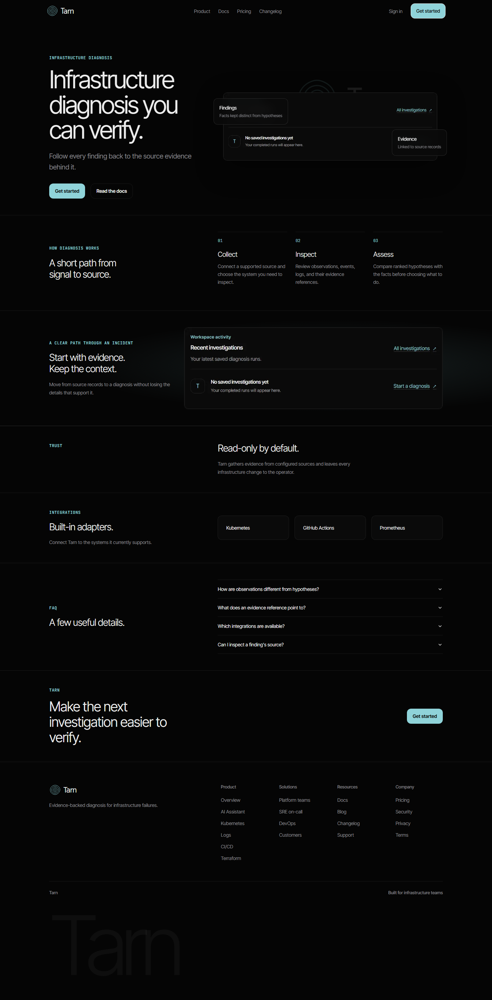
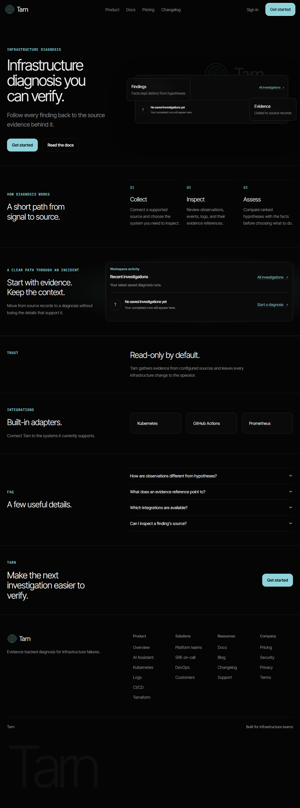
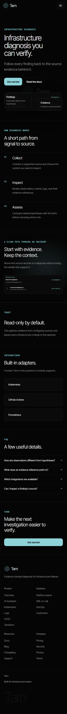
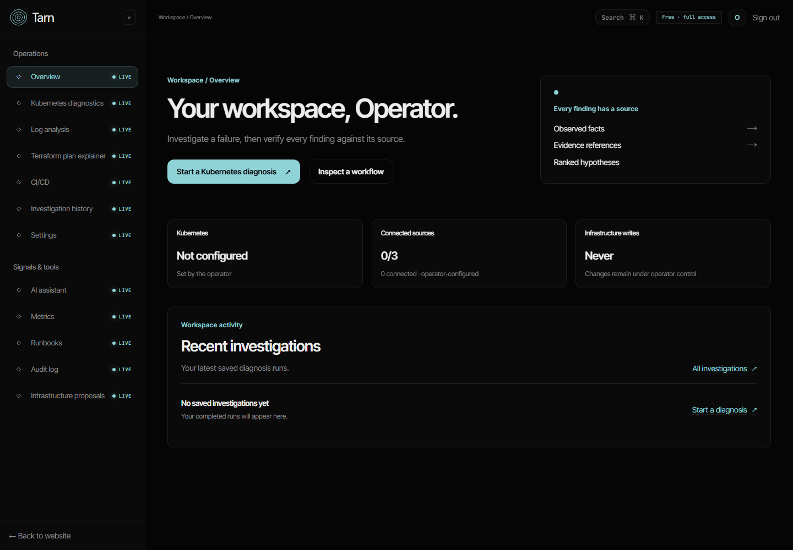
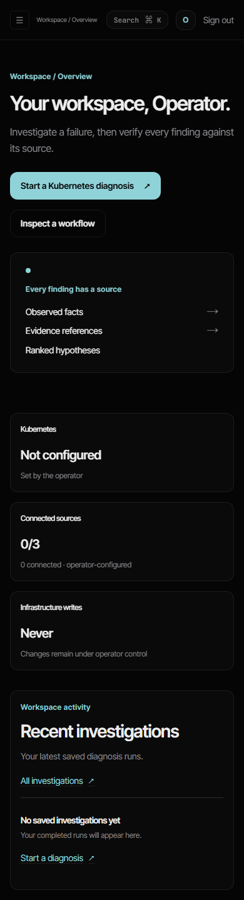
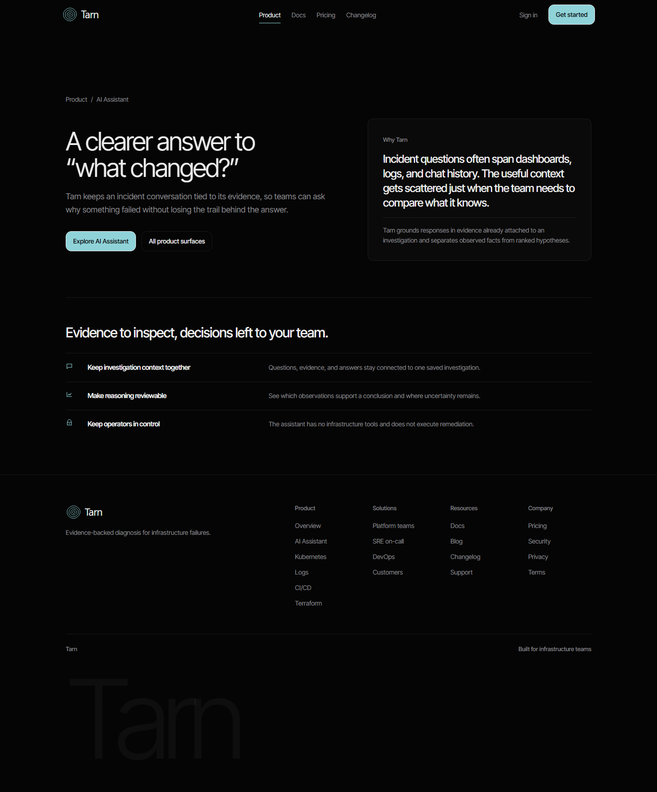
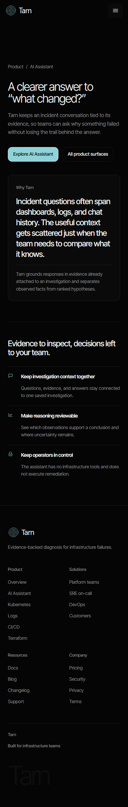

# Tarn UI refinement audit

## Screenshot evidence

The original homepage baseline is retained under `ui-refine/before`. Final
captures are under `ui-refine/after`, taken from the local frontend at these
viewports. Product detail pages were recaptured after removing the repeated
eyebrow. Public-page captures emulate reduced motion so scroll-reveal content
is visible in each full-page image; dashboard captures use screenshot-only
empty-state API responses.

| Page | 1440 px | 1024 px | 390 px |
|---|---|---|---|
| Homepage |  |  |  |
| Dashboard |  | Not requested |  |
| Product detail: AI Assistant |  | Not requested |  |

Other product detail pages have paired 1440/390 captures in
`ui-refine/after`: Kubernetes, logs, metrics, runbooks, CI/CD, Terraform,
infrastructure code, and audit. Marketing, reading, pricing, and auth page
captures from their completed batches are retained in the same folder.

## Layout/alignment

- The homepage, product detail pages, and dashboard use a centered container.
  The dashboard sidebar remains separate from the public marketing navigation.
- Product detail pages previously repeated the same breadcrumb as a hero
  eyebrow. The duplicate label is removed; the breadcrumb now appears once.
- A complete signed-in visual review of every internal product route was not
  possible without a real workspace session.

## Spacing

- Homepage sections share a consistent vertical rhythm and align to the same
  content width.
- Product detail pages use one hero pattern followed by a single feature list;
  their repeated breadcrumb-to-heading gap has been reduced.
- The dashboard's overview, status cards, and recent-investigations panel align
  to its workspace content column at desktop and stack cleanly on mobile.

## Typography

- Inter Tight is used for display and interface text; JetBrains Mono is reserved
  for code and evidence references. The serif token aliases the sans font.
- Six named type tokens are defined centrally, with a responsive display token.
  Older data-dense product screens still contain some small metadata sizes that
  are not expressed through the named scale.

## Color/contrast

- The site uses the single black base (`#050505`), elevated surface (`#0A0A0A`),
  shared hairline, light text, and glacial action color.
- Amber and brick remain semantic status colors. No sampled screenshot showed
  text placed over a busy background.

## Backgrounds and decoration

- Continuous grid overlays are disabled so the product surfaces do not compete
  with evidence and reading content.
- The homepage keeps the faint Tarn mark and the single product-shot treatment.
  Its screenshot is a real empty workspace, not a live diagnosis.
- A real diagnosis screenshot from a local kind cluster is still needed; kind
  and kubectl are unavailable in this environment.

## Components

- Public navigation has four plain destination links, sign-in, and one primary
  action; secondary site links remain in the footer sitemap.
- Cards, buttons, borders, and radii use shared rules. Pricing facts continue
  to come from the existing entitlement catalog.
- Dashboard integration and investigation values remain API-driven; the
  screenshots use an empty history and unconfigured integrations only.

## Responsiveness

- The homepage was captured at 1440, 1024, and 390 px. Product detail pages and
  the dashboard were captured at 1440 and 390 px.
- Captured layouts remained within their viewport widths. This does not replace
  an interactive pass over every authenticated route and menu state.
- The earlier 40-route responsive smoke pass predates the final visual batch;
  it included the public demo route that has since been removed.

## Motion

- Homepage cards use restrained floating motion; scroll entrances and hover
  states are short. Reduced-motion styling disables decorative motion.
- The former continuously drifting product grid backdrop is disabled.

## Bugs

- Fixed repeated product breadcrumb/eyebrow text.
- Removed a duplicate read-only note and a fabricated sample question from the
  assistant entry surface.
- No captured page had horizontal overflow. Authenticated API behavior was not
  changed, and backend fixtures/tests were not edited.

## Remaining review items

- Replace the homepage empty-workspace image with a real diagnosis screenshot
  after a local kind-cluster capture is available.
- Run the full required test/build gates and complete one final interactive
  check of menus and authenticated pages before deployment.
