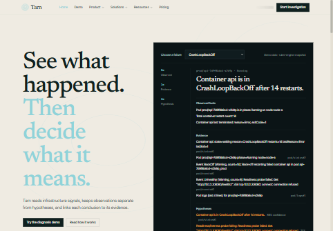
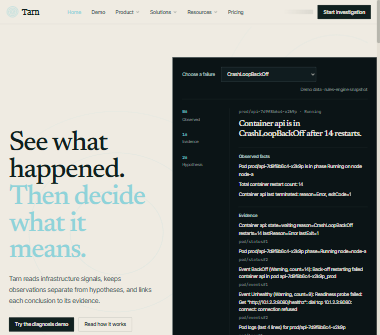
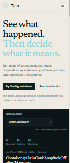

# Tarn UI refinement audit

Baseline: `new-ui` at `691f232` (`new-ui-before-refine`), captured before
homepage changes. The marketing pages use a paper theme, but the homepage
alternates paper and dark sections. The screenshots below show the initial
viewport at each requested width.

| Width | Screenshot |
| --- | --- |
| 1440 px |  |
| 1024 px |  |
| 390 px |  |

## Layout/alignment

- The homepage is assembled from several independent layouts: the hero, three
  product links, a separate steps layout, customer questions, trust checklist,
  integration strips, pricing teaser, FAQ, and a final CTA. Their inner
  containers and alignments do not read as one page grid.
- The hero gives a very long headline and a dense diagnosis panel equal visual
  importance. At desktop width the headline still breaks into several short
  lines, while the panel presents many rows of small evidence text.
- The top navigation packs six destinations and a call to action into one row.
  At small widths it collapses to a menu, but the menu exposes the full nested
  product and resource list rather than a concise home-page path.
- In the route pass, `/assistant` returned a generic Tarn document title and no
  `h1`; the navigation's “Start investigation” CTA points there for signed-out
  visitors.

## Spacing

- The homepage measures about 6,963 px tall at 1440 px wide. Several large
  section paddings, a second CTA, and repeated integrations and trust material
  make the journey much longer than its content requires.
- Large gaps separate the hero, feature list, steps, CTA, customer placeholder,
  trust section, integrations, pricing, FAQ, and final CTA. The 390 px layout
  magnifies this into a long, repetitive scroll.
- The evidence panel is vertically dense inside a much more spacious page;
  section rhythm and content density feel unrelated.

## Typography

- Three font families are loaded and used: Newsreader for display headings,
  Inter Tight for interface text, and JetBrains Mono for labels and evidence.
  The serif display style makes the otherwise technical homepage feel
  editorial, and the frequent size jumps do not form one clear scale.
- The hero's accent-colored second sentence is large enough to compete with
  the first. Inside the diagnosis panel, resource labels, evidence, and
  confidence text become very small, especially at 390 px.
- Several headings repeat similar claims (“evidence”, “diagnosis”, “source”)
  without a clear hierarchy between them.

## Color/contrast

- Bone sections alternate with near-black trust, CTA, and panel sections on a
  single marketing page.
- Glacial cyan is used for large text over bone. Its light tone is decorative,
  not a readable text color on that surface.
- The shared accent button pairs white text with glacial cyan, which does not
  provide sufficient contrast for a primary action.
- Muted labels and the evidence panel's smallest metadata are difficult to
  read at mobile scale.

## Backgrounds and decoration

- Contour lines sit behind the hero copy, and the page also uses glow/gradient
  treatments and dark section fills. These compete with the headline and
  evidence instead of helping the user scan.
- The diagnosis panel's left-side depth scale adds a decorative rail to an
  already dense evidence view.
- The full-width dark sections and section boundaries make the page feel like
  several visual treatments stitched together.

## Components

- The homepage uses several distinct surface treatments: diagnosis panel,
  bordered trust checklist, gray integration tiles, pricing card, dark final
  CTA, and FAQ rows. There is no single card or border treatment.
- The same integrations are presented twice. The current list also names
  PostgreSQL, OpenTelemetry, SMTP, and Sentry, which are not present as
  implemented adapters in this checkout. Kubernetes, GitHub, and Prometheus
  are implemented.
- “No customer stories published yet” and design-partner questions make the
  homepage read like an unfinished placeholder rather than a product
  introduction.
- Read-only and no-account disclaimers recur in the hero, trust section,
  final CTA, and footer. The repeated qualification feels stacked.
- The customer panel, pricing teaser, and two CTAs displace the requested core
  sequence: how diagnosis works, a no-signup sample demo, trust, real
  integrations, and FAQ.
- Navigation and homepage CTA behavior should lead first-time visitors to the
  working demo rather than the signed-out `/assistant` route.

## Responsiveness

- All 40 tested routes returned HTTP 200 at 1440, 1024, and 390 px; none had
  horizontal document overflow at those widths. Authentication-gated product
  routes correctly rendered the sign-in flow in the signed-out browser.
- The homepage fits 390 px without horizontal scrolling, but its headline
  breaks into several lines and its evidence panel is text-heavy. The long
  sequence of sections makes the mobile page unnecessarily tall.
- At 1024 px the hero remains a two-column composition; the headline and
  evidence panel are both dense for the available width.
- Dropdowns and menu interactions were not part of this static route pass.

## Motion

- The shared `Reveal` transition lasts 850 ms, longer than the requested
  restrained 200–300 ms fade-up.
- The shared stylesheet also contains continuous glow, grid-drift, signal
  pulse, and other decorative animations. They add motion unrelated to
  reading a diagnosis.
- Reduced-motion behavior exists for the shared reveal, but continuous
  decorative effects make the motion model inconsistent.

## Bugs

- The home navigation's signed-out “Start investigation” link points to
  `/assistant`, which had no heading in the baseline route pass. A first-time
  visitor should get the working no-signup demo instead.
- The homepage labels several unimplemented connector names as integrations
  and repeats the integration list, which misstates product availability.
- No HTTP failures or horizontal overflow were observed in the 40-route
  responsive pass. Route checks do not replace interactive testing of
  dropdowns, forms, or authenticated states.

## Routes opened

The pass opened the following route patterns at 1440, 1024, and 390 px:

`/`, `/blog`, `/changelog`, `/customers`, `/customers/case-studies`,
`/customers/testimonials`, `/demo`, `/docs`, `/pricing`, `/privacy`,
`/product`, `/product/kubernetes`, `/resources`, `/security`, `/solutions`,
`/solutions/devops`, `/solutions/platform`, `/solutions/sre`, `/support`,
`/terms`, `/admin/settings`, `/assistant`, `/audit`, `/cicd`, `/dashboard`,
`/dashboard/coming-soon`, `/dashboard/upgrade`, `/history`, `/infra-code`,
`/kubernetes`, `/logs`, `/metrics`, `/runbooks`, `/settings`, `/terraform`,
`/forgot-password`, `/login`, `/reset-password`, `/sign-up`, `/verify-email`.

The dynamic product route was opened as `/product/kubernetes`. The UI changes
that follow this audit are restricted to the homepage and its home-only
navigation/footer presentation; other pages are left for approval.
